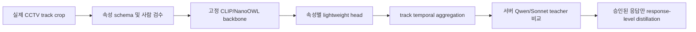

# 속성 증류·파인튜닝 상한 실험 보고서

> **중요:** 아래 72.67%는 프로젝트 운영 속성의 ceiling이 아니다. PA-100K에서 측정 가능한 6개 proxy field의 best observed result이며, 프로젝트가 요구하는 `color`, `clothing`, `texture`, `quality`, `occlusion`은 아직 측정하지 않았다.

이 문서에서 말하는 상한은 정확한 이론적 ceiling이 아니라, 이번에 실행한 3개 recipe와 100장 proxy 범위에서 관측된 `best observed proxy result`다.

## tl;dr

현재 확보된 proxy 데이터와 시험한 recipe에서 관측된 **6-field best observed proxy result**는 다음과 같다.

| 실험 | 검증 속성 정확도 | Macro-F1 | 판정 |
|---|---:|---:|---|
| 고정 CLIP + 다중 속성 헤드, 120 epoch | 71.67% | 41.01% | 기준 |
| CLIP 마지막 2개 vision layer + projection + 헤드, 8 epoch | 68.83% | 30.09% | 기준 미달 |
| 같은 부분 fine-tuning, 40 epoch | **72.67%** | **43.55%** | 현재 최선, 기준보다 1.00%p 높음 |

따라서 지금 proxy 데이터와 시험 범위에서의 결론은 **40 epoch 부분 fine-tuning이 고정 CLIP+head보다 1.00%p 높았지만, 8 epoch는 오히려 낮았고 fine-tuning의 이득이 작다**는 것이다. 현재는 fine-tuning 40 epoch를 best observed recipe로 기록하되, 실제 CCTV 데이터에서 다시 선택해야 한다.

프로젝트 운영 속성의 판정은 `real CCTV track split`에서 별도로 다시 해야 하며, 이 실험만으로 production 속성 ceiling을 확정하지 않는다.

다만 이 수치는 실제 CCTV의 색상·질감·복장·신원 일치율이 아니다. PA-100K의 100장 proxy와 6개 라벨만 사용했으며, 사람별 track ID가 없어 image-level 5-fold로 검증했다. 실제 CCTV 상한은 아직 측정되지 않았다.

## 실험 목적과 증류와의 관계

Sonnet 5 또는 다른 VLM의 응답을 student가 학습하는 것은 현재 프로젝트 조건에서 logit KD가 아니라 **response-level teacher-label distillation**이다. 즉 teacher가 만든 구조화 속성 응답을 승인·검수한 뒤 student의 정답으로 사용한다.

이번 실험은 teacher API가 없는 상태에서 가능한 **gold-label supervised transfer**다. 사람이 검증한 라벨로 student를 학습한 결과이므로, 같은 라벨 체계와 같은 이미지 난이도에서 response-level distillation이 도달할 수 있는 상한의 proxy로 사용할 수 있다. teacher가 틀린 pseudo-label을 추가하면 이 값보다 좋아진다고 보장할 수 없고, 보통은 라벨 노이즈만큼 낮아진다.

아직 Sonnet 5 응답을 이용한 실제 distillation은 실행하지 않았다. API와 teacher 라벨이 없는데 결과를 만들면 증류 성능이 아니라 가정값이 되기 때문이다.

## 데이터와 검증 설계

- 데이터: `experiments/data/cctv_proxy/pa100k`
- 샘플: 이미지 100장
- backbone: 로컬 `openai/clip-vit-base-patch32`
- 장치: CUDA, 로컬 RTX 4050 Laptop GPU
- 분할: seed 17의 deterministic image-level 5-fold, 각 fold train 80 / validation 20
- 라벨: `gender`, `age`, `viewpoint`, `accessory_present`, `sleeve`, `bottom_type`
- 지표: 6개 field의 평균 정확도와 class-wise macro-F1

현재 proxy에는 프로젝트가 실제로 요구하는 머리색, 상·하의 색, 재질·질감, 신원 ID, 영상 track 일관성 라벨이 없다. 또한 manifest의 pattern 계열 라벨이 모두 0건이어서 `pattern`은 실험 field에서 제외했다. `SkirtDress` 키는 manifest 원문에 맞춰 읽는다.

각 JSON에는 seed, head/fine-tuning epoch, Python·PyTorch·Transformers 버전, GPU 이름과 PA-100K manifest SHA-256이 함께 기록된다. checkpoint는 `local_files_only=true`로 로컬 캐시에서만 읽었다.

## 필드별 결과

### 고정 CLIP + 속성 head

| 속성 | validation 정확도 |
|---|---:|
| gender | 66.00% |
| age | 97.00% |
| viewpoint | 41.00% |
| accessory_present | 62.00% |
| sleeve | 83.00% |
| bottom_type | 81.00% |

### 부분 CLIP fine-tuning, 40 epoch

| 속성 | validation 정확도 |
|---|---:|
| gender | 69.00% |
| age | 97.00% |
| viewpoint | 41.00% |
| accessory_present | 64.00% |
| sleeve | 84.00% |
| bottom_type | 81.00% |

fold별 validation 속성 정확도의 표준편차는 고정 CLIP 5.37%p, 40 epoch fine-tuning 6.30%p였다. 고정 CLIP의 학습 정확도는 93.50%인데 validation은 71.67%로 21.83%p 차이가 나며, fine-tuning 40 epoch는 train 97.54%와 validation 72.67%로 24.88%p 차이가 난다. 현재 데이터에서는 학습셋 성능을 배포 성능으로 보면 안 된다. 6-field 단순 majority baseline은 69.83%다.

## 해석

1. 이번 proxy benchmark에서 관측된 최선은 평균 6-field 속성 정확도 72.67%다. 이를 프로젝트 운영 속성의 80% 이상 달성이나 정확한 ceiling으로 보고할 수 없다.
2. age와 bottom_type은 상대적으로 높지만 프로젝트의 판별력을 대표하지 않는다. viewpoint와 gender가 각각 41%, 69%로 병목이다.
3. fine-tuning 40 epoch가 8 epoch보다 좋아졌고 기준보다 1.00%p 높았지만, train-validation gap이 더 크다. 데이터가 100장뿐인 상태에서 이 작은 차이만으로 backbone fine-tuning을 확정할 수 없다.
4. 특히 색상·질감은 이 실험의 라벨에 없으므로, 이 결과로 색상·질감 성능을 추정할 수 없다. 실제 CCTV crop에 색상·질감 라벨을 추가해야 한다.

## 프로젝트에 적용할 결론

현재 단계의 embedded student는 다음 순서가 합리적이다.



- NanoOWL/CLIP에 한 번에 모든 의미 판단을 억지로 넣기보다, 속성 head를 분리하고 track 단위 다수결·confidence aggregation을 적용한다.
- Qwen 또는 Sonnet의 teacher 결과는 바로 학습에 넣지 말고 `teacher confidence`, `teacher agreement`, 사람 검수 상태를 기록한다.
- 서버 Qwen의 최종 후보 판단은 이 속성 classifier의 평균 정확도와 별도 지표다. 후보 순위, false positive, 동일인/타인 pair verification을 별도로 측정해야 한다.
- 실제 배포 승인 기준은 이 proxy의 72.67%가 아니라 **real CCTV track split에서 attribute macro-F1, same/different pair AUPRC, false-positive rate, track-level exact match를 함께 통과하는 것**으로 둔다.

## 재현 명령

8 epoch 기준 결과:

```powershell
uv run --extra-index-url https://download.pytorch.org/whl/cu128 `
  --with 'torch==2.11.0+cu128' `
  --with 'transformers==5.14.1' `
  --with 'pydantic>=2.10' `
  --with 'pillow>=11.0' `
  python scripts/run_attribute_ceiling_experiment.py `
  --output experiments/results/attribute-ceiling.json
```

40 epoch 기준 결과:

```powershell
uv run --extra-index-url https://download.pytorch.org/whl/cu128 `
  --with 'torch==2.11.0+cu128' `
  --with 'transformers==5.14.1' `
  --with 'pydantic>=2.10' `
  --with 'pillow>=11.0' `
  python scripts/run_attribute_ceiling_experiment.py `
  --finetune-epochs 40 `
  --output experiments/results/attribute-ceiling-ft40.json
```

원시 결과:

- `experiments/results/attribute-ceiling.json`
- `experiments/results/attribute-ceiling-ft40.json`
- 실행 코드: `scripts/run_attribute_ceiling_experiment.py`

## 다음 실험 없이는 확정할 수 없는 것

- Sonnet 5 teacher 응답을 실제로 사용한 distillation gain
- Qwen teacher와 Sonnet teacher의 속성별 disagreement
- CCTV 저해상도·가림·야간·측면 영상에서의 색상·질감 성능
- 서로 다른 사람 3명이 비슷한 옷을 입은 상황의 same/different 판단
- 영상 track aggregation 후 false-positive 감소량

따라서 현재 결과는 “모델을 무엇으로 확정했는가”가 아니라, **현재 proxy에서 측정된 학습 방식의 상한과 데이터 부족으로 인한 미확정 경계**다.
